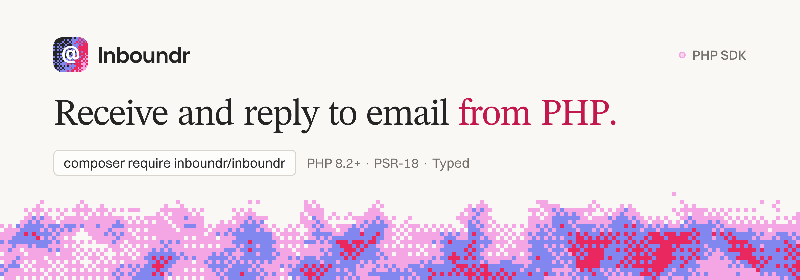

# Inboundr PHP SDK

[](https://packagist.org/packages/inboundr/inboundr)
[](./LICENSE)

PHP library for the [Inboundr](https://inboundr.net) API: receive email over signed webhooks, read and reply to it, and manage domains, addresses and endpoints.

- [Quickstart](https://inboundr.net/docs/quickstart)
- [API reference](https://inboundr.net/docs/api-reference/introduction)
- [Verifying webhooks](https://inboundr.net/docs/webhooks/verifying-signatures)

## Install

```bash
composer require inboundr/inboundr guzzlehttp/guzzle
```

PHP 8.2+. Works with any PSR-18 HTTP client; with Guzzle installed it uses Guzzle with a 30 second timeout.

## Setup

Create an API key in the console under **API keys**, then:

```php
use Inboundr\Inboundr;

$client = new Inboundr('inb_123456789');
```

With no argument, the key is read from `INBOUNDR_API_KEY`.

## Receive email

Every inbound email is delivered to your endpoint as a signed `POST`. Verify it with the raw request body and the request's headers:

```php
use Inboundr\Exception\SignatureException;
use Inboundr\Webhook;

try {
    $event = Webhook::verify(file_get_contents('php://input'), $_SERVER, $webhookSecret);
} catch (SignatureException) {
    http_response_code(400);
    exit;
}

$email = $event['email'];
error_log("{$email['from']}: {$email['subject']}");
http_response_code(204);
```

The secret is the `whsec_` value returned when you create the endpoint. Pass the body exactly as received: decoding and re-encoding the JSON changes it and breaks the signature.

Headers can be `$_SERVER`, `getallheaders()`, a PSR-7 message, or a Symfony/Laravel `$request->headers`. With a PSR-7 request, `Webhook::verifyRequest($request, $secret)` reads both.

### Retries

Failed deliveries are retried with the same delivery id. To skip deliveries you have already handled, verify with `verifyDelivery`, which also checks the signature on the delivery id:

```php
$delivery = Webhook::verifyDelivery(file_get_contents('php://input'), $_SERVER, $webhookSecret);

if (alreadyHandled($delivery->deliveryId)) {
    http_response_code(204);
    exit;
}
$email = $delivery->event['email'];
```

Don't deduplicate on the `x-inboundr-delivery-id` header read directly: it isn't covered by the body's signature, so a replayed delivery could carry any id.

### Missing body

Some hosts drop the request body. The delivery still carries a signed email id, so you can fetch the email instead:

```php
// when Webhook::verify throws with $e->reason === 'missing_body'
$ids = Webhook::verifyIds($_SERVER, $webhookSecret);
$email = $client->emails->get($ids->emailId);
```

### Failure reasons

`SignatureException::$reason` is one of:

| Reason | Meaning |
| --- | --- |
| `missing_secret` | No secret was passed. |
| `missing_header` | No signature header. |
| `malformed_header` | The signature header can't be parsed. |
| `invalid_signature` | The signature doesn't match. |
| `timestamp_out_of_tolerance` | Signed more than 5 minutes ago (pass `toleranceSeconds` to change). |
| `missing_body` | Signed, but the body is empty. |
| `invalid_payload` | Verified, but not a known event. |

## Read email

```php
$page = $client->emails->list(['direction' => 'inbound', 'limit' => 20]);

$email = $client->emails->get($page['data'][0]['id']);
$thread = $client->threads->get($email['threadId']);
```

To go through every page:

```php
foreach ($client->emails->listAll(['direction' => 'inbound']) as $email) {
    echo $email['subject'], "\n";
}
```

Requests and responses are arrays with the API's field names. Their shapes are declared for PHPStan and Psalm, so static analysis and your editor know every field.

## Reply and send

```php
$client->emails->reply($email['id'], ['text' => "Thanks, we're on it."]);

$client->emails->send([
    'from' => 'agent@yourdomain.com',
    'to' => ['customer@example.com'],
    'subject' => 'Your order shipped',
    'html' => "<p>It's on the way.</p>",
]);
```

Sending needs a connected sender or a verified domain with sending enabled.

## Attachments

```php
// A signed URL, valid for 15 minutes
$url = $client->emails->attachmentUrl($email['id'], 0)['url'];

// Or the file itself
$bytes = $client->emails->downloadAttachment($email['id'], 0);
```

## Resources

| Resource | Methods |
| --- | --- |
| `emails` | `list`, `listAll`, `get`, `send`, `reply`, `delete`, `retry`, `attachmentUrl`, `downloadAttachment` |
| `threads` | `get` |
| `domains` | `list`, `create`, `get`, `update`, `delete` |
| `addresses` | `list`, `create`, `get`, `update`, `delete` |
| `endpoints` | `list`, `create`, `get`, `update`, `delete`, `test`, `deliveries`, `listAllDeliveries` |
| `shieldRules` | `list`, `create`, `get`, `update`, `delete`, `move`, `reorder` |
| `senders` | `list` |
| `suppressions` | `list`, `create`, `delete` |
| `forwardDestinations` | `list`, `create`, `delete` |

See the [API reference](https://inboundr.net/docs/api-reference/introduction) for parameters and responses. The array shapes live in `Inboundr\Generated\Types`:

```php
/** @phpstan-import-type Email from \Inboundr\Generated\Types */
```

## Errors

| Exception | Thrown when | Properties |
| --- | --- | --- |
| `ApiException` | The API returns a non-2xx status | `status`, `body`, `requestId` |
| `RateLimitException` | The API returns `429` | `retryAfterSeconds` |
| `InboundrException` | The request fails, or the response isn't the API's | |

All live in `Inboundr\Exception` and extend `InboundrException`.

```php
use Inboundr\Exception\ApiException;

try {
    $client->domains->create(['domain' => 'example.com']);
} catch (ApiException $e) {
    echo $e->status, ' ', json_encode($e->body);
}
```

Requests are not retried automatically.

## Options

```php
$client = new Inboundr(
    apiKey: 'inb_123456789',
    baseUrl: 'https://inboundr.net', // default
    timeout: 30.0,                   // seconds, for the Guzzle client built for you
    httpClient: $psr18Client,        // optional, any PSR-18 client
);
```

With your own `httpClient`, set its timeout on that client. Pass `requestFactory` and `streamFactory` too if no PSR-17 factories are installed.

## Contributing

See [CONTRIBUTING.md](./CONTRIBUTING.md).

## License

MIT
